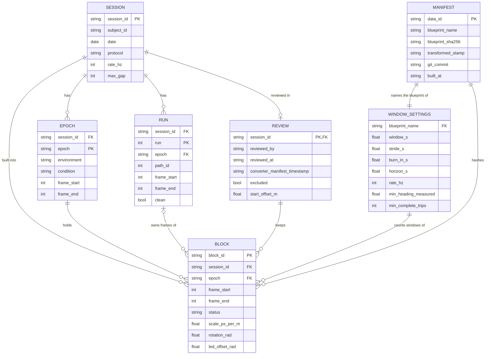

# Blocks schema

The files the block step reads and writes, as `src/axis_of_travel_rnn/blocks/` writes them (engine version 2, review format version 4):
their layout, columns and keys in the order the files hold them, with type, unit and default. What each one means is in
`DATA_DICTIONARY.md` at the root, under the entry of the same name (the built blocks section unless a line says otherwise). The lab's
files and the transformed tables are in `docs/transform_lab_data/tables.md`.

## The three folders

| folder | named by | written by | in the repository |
|---|---|---|---|
| transformed | `TRANSFORMED_LAB_DATA` in `configs/local.yaml` | `pixi run transform-lab-data` | no, read only here, its tables in `docs/transform_lab_data/tables.md` section 2 |
| reviews | `PROCESSED_LAB_DATA/review/`, or the blueprint's `reviews` | the review tool | no, travels with the processed folder |
| built | `PROCESSED_LAB_DATA/<blueprint>/` | `pixi run build-blocks --blueprint <name>` | no |

The build reads `sessions.csv`, `epochs.csv`, `runs.csv`, `annotations.csv` (optional), `frames/{sid}.parquet` and the converter's
`manifest.json` (its `run.timestamp` is the transformed stamp).

## Reviews: `PROCESSED_LAB_DATA/review/{sid}.json`

Written whole by the review tool, one per session. A key an older file lacks takes the default in brackets. Meanings: see the review
entries of `DATA_DICTIONARY.md`.

| key | type |
|---|---|
| `session_id` | str |
| `reviewed_by`, `reviewed_at` | str, ISO time, null until saved |
| `converter_manifest_timestamp` | str |
| `rules` | object |
| `blocks` | list of `block_id`, `epoch`, `environment`, `frame_start`, `frame_end`, `status`, `note` |
| `cuts` | list of `frame_start`, `frame_end`, `reason` |
| `flagged_runs` | list of int |
| `notes` | str |
| `edits` | list of edits, `op` one of `accept`, `confirm`, `move`, `split`, `drop`, `new`, `cut`, `trips` |
| `excluded` (false) | bool |
| `excluded_by`, `excluded_at` (null) | str |
| `start_offset_m` (null) | float, m |

## Built folder: `PROCESSED_LAB_DATA/<blueprint>/`

```
manifest.json               the build and its data id
blocks.csv                  one row per block
blocks/{block_id}.parquet   one row per frame of the block, at the lab rate (60 Hz)
metadata/{sid}.json         one per built session
```

### `blocks/{block_id}.parquet`

| column | type | unit |
|---|---|---|
| `frame` | int32 | frame (transformed section) |
| `t` | float64 | s (transformed section) |
| `x`, `y` | float64 | m |
| `heading` | float64 | rad |
| `speed` | float64 | m/s |
| `turn_rate` | float64 | rad/s |
| `n_lights` | int8 | count |
| `heading_filled` | bool | |
| `heading_held` | bool | |
| `filled_front`, `filled_back` | bool | |
| `phase` | string | |
| `trip` | int32 | |
| `run` | int32 | |
| `path_id` | int16 | |
| `clean` | bool | |

### `blocks.csv`, one row per block, sorted by session

| column | type | unit |
|---|---|---|
| `block_id` | str | |
| `session_id`, `subject_id` | str | (transformed section) |
| `date` | str | YYYY-MM-DD |
| `protocol`, `environment`, `epoch` | str | (transformed section) |
| `kind` | str | |
| `frame_start`, `frame_end` | int | frame |
| `n_frames` | int | frames |
| `duration_s` | float | s |
| `rate_hz` | int | Hz |
| `n_runs`, `n_clean_runs`, `n_trips`, `n_complete_trips` | int | count |
| `heading_lost_s`, `heading_filled_s`, `heading_held_s` | float | s |
| `status`, `reviewed_by` | str | |
| `scale_px_per_m` | float | px/m |
| `rotation_rad`, `led_offset_rad` | float | rad |
| `kinematics_version` | int | |

### `metadata/{sid}.json`, written whole

| key | holds |
|---|---|
| `rules`, `settings` | the full rules and settings, defaults with the blueprint's overrides |
| `review_stamp` | `reviewed_at`, `converter_manifest_timestamp` |
| `code_version` | str |
| `built_at` | UTC time to the second |
| `windows` | per block id, `count` and `verdict` (`ok`, `reasons`) |
| `frame` | the registration: `led_offset_rad`, `led_offset_r`, `led_offset_n`, `start_px`, `goals_px`, and per kind (`track`, `arena`) `scale_px_per_m`, `led_separation_m`, `rotation_rad`, `rotation_concentration`, `flip`, `offset_m`. The track adds `scale_x_px_per_m`, `scale_y_px_per_m`, `start_offset_measured_m`, the arena `arena_extent_ratio`. Null when excluded |
| `warnings` | list of str |
| `failed` | list of `block_id` and `problems` |
| `excluded` | bool |
| `start_offset_m` | float, m, or null |

### `manifest.json`

| key | holds |
|---|---|
| `blueprint` | `name`, `sha256` of the blueprint's own section in canonical json (sorted keys, no spaces, so comments do not count), `format_version` |
| `data_id` | sha256 hex |
| `transformed_stamp` | str |
| `git_commit`, `package_version`, `engine_version`, `built_at` | str, str, int, UTC time |
| `counts` | `sessions_built`, `blocks_written`, `failed_blocks`, `skipped_sessions`, `excluded_sessions`, `errors` |
| `failed`, `skipped`, `excluded`, `errors` | by session: failed blocks, the skip reason, excluded ids, the error message |

The data id hashes, in this order, `blocks.csv` then every `blocks/{block_id}.parquet` in block id order, one line each: the path
inside the build folder, a space, the sha256 of the file's bytes, a newline. `scripts/compare_blocks.py OLD NEW` compares two built
folders by content.

## Blueprint: `blueprints.{name}` in `configs/project.yaml`

One entry of the `blueprints` section, keyed by its name. Read by `blocks/blueprint.py` (`read_blueprint(name)`), which refuses
an unknown key, an unknown rule or setting name, and a wrong type. The manifest's `sha256` is of this section alone, as json with
sorted keys and no spaces, so another section of the file changing leaves it as it is.

| key | default |
|---|---|
| `name` | required |
| `format_version` | required |
| `description` | empty |
| `transformed` | required, `TRANSFORMED_LAB_DATA` |
| `reviews` | null, meaning `PROCESSED_LAB_DATA/review/`, else a folder relative to the repository or absolute |
| `sessions` | required, `all_reviewed` or a list of session ids |
| `rules` | `{}` |
| `settings` | `{}` |
| `start_offsets` | `from_reviews`, or session id to metres |
| `expected_data_id` | null |
| `built` | null, meaning `PROCESSED_LAB_DATA/<name>/`, else a folder relative to the repository (the sample's `tests/fixtures/sample`) |

## Rules and settings

The defaults of `RULES` and `SETTINGS` in `blocks/__init__.py`, grouped as the code groups them.

- Epochs cut: `condition` baseline, `epochs` (arena, track).
- Cut points: `pause_step_s` 0.1, `gap_lights` both, `jump_px` 40.0.
- Blocks: `pause_margin_s` 5.0, `min_block_s` 10.0, `snap_s` 1.0.
- Heading: `heading_fill_s` 3.0, `running_floor_m_per_s` 0.03.
- Labels: `outbound_paths` (1, 2, 3, 4), `return_paths` (9, 10), `pause_min_s` 1.0.
- Track scale: `histogram_bin_px` 2.0, `peak_smooth_bins` 5, `peak_prominence` 0.1, `axis_agree` 0.05.
- Arena against track: `camera_height_m` 2.6, `track_height_m` 0.2, `arena_height_m` 0.4.
- LEDs: `nominal_led_separation_m` 0.05, `extent_percentiles` (1, 99), `led_separation_m` (0.04, 0.08).
- Motion: `speed_smooth_frames` 6, `running_px_per_s` 20.0, `offset_warn_deg` 30.0 (not read by any code today).
- Checks: `t_step_tolerance_s` 1e-6.
- Kinematics: `smooth_window_s` 0.15, `smooth_order` 2, `kinematics_version` 1.
- Settings: `window_s` 40.0, `stride_s` 10.0, `burn_in_s` 1.0, `horizon_s` 0.5, `rate_hz` 20, `min_heading_measured` 0.8, `min_complete_trips` 1.

## Keys and links

Every file joins on `session_id`. A block names its epoch (`epoch`) and, per frame, the run that owns it (`run`). A review names its
blocks by `block_id`. The manifest hashes the blocks into the data id and names the blueprint whose settings gave each block its
window count.


