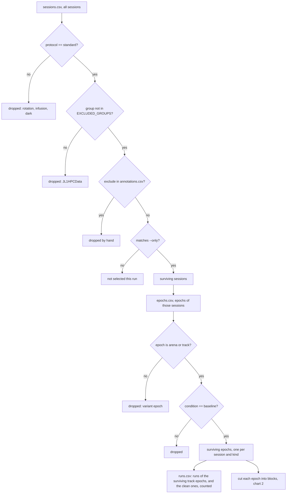
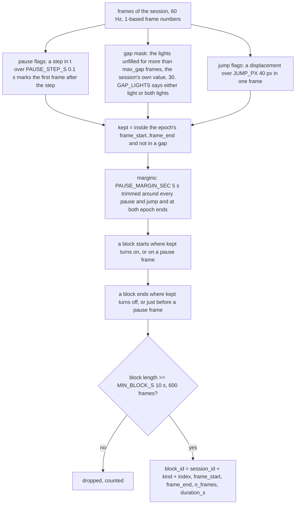

# How blocks are selected

The logic of `select.py` as two charts: the funnel over the tables, then the cut of one epoch
into blocks. Every named value is a constant at the top of `select.py`.

## 1. The funnel, from the four tables to the epochs that become blocks



The count after every box is printed by the dry run and written to the manifest.

## 2. One epoch into blocks

Four things cut (a pause, a both-lights gap, a jump, an epoch bound), margins trim, one thing drops. A cut ends the current block and starts a new one on the
next kept frame. The cut points are found over the whole session first, then the epoch's
frame range is applied.



Decision 2026-10-14: GAP_LIGHTS = "both". The two dry runs (62 sessions, 124 epochs):

| | either light | both lights |
|---|---|---|
| stretches cut | 6,897 | 599 |
| blocks kept (at least 10 s) | 3,258 | 494 |
| track blocks, time kept | 2,994, 19.1 h | 401, 24.6 h |
| track block median, 90th percentile, max | 15 s, 41 s, 9 min | 77 s, 9.8 min, 30 min |
| arena blocks, median | 264, 55 s | 93, 186 s |

Position therefore comes from the lab's mashup light (the one good LED when the other is lost,
up to about 2.5 cm from the midpoint), recorded per frame as `n_lights`, and heading is NaN on
those frames. About a third of the track time is still lost to both LEDs being out for over
half a second and to stretches under 10 s.

First real dry run (2026-10-13, GAP_LIGHTS either): 109 sessions, 76 standard, 62 after dropping
JL1HPCData, 124 epochs, 9,980 runs of which 7,084 clean, 6,897 stretches cut, 3,258 blocks of at
least 10 s (264 arena, 6.0 h, and 2,994 track, 19.1 h, mean track block 23 s). Pauses exist in
only 32 sessions, so almost every cut is one lost light for over half a second. The "both"
rule, position from the lab's mashup light, is the alternative under test.

Decision 2026-10-14, four classes of quality issue (Kyle): pauses cut (as before). Handling around
pauses and at the epoch edges: a 5 s margin trimmed. Both LEDs lost: position is never
interpolated, the gap cuts as before. One LED lost: heading only, a label, never cuts, filled by
circular linear interpolation up to 3 s and flagged, NaN beyond. Transportation (a jump over 40
px in one frame): cuts with the same margin. RatReplay draws every rule's effect with display
toggles, the constants live in the processor.

Dry run with all four rules (2026-10-14): 1,772 stretches, 594 after the margins, 498 blocks of
at least 10 s, 405 on the track (24.4 h, median 78 s) and 93 in the arena (6.2 h). 1,173 jump
frames, 1,486 s trimmed by margins. Against the gap rule alone the rules cost about 1 percent of
the time and change the block picture not at all.

What stays inside a block on purpose: an unfilled stretch of max_gap frames or shorter (the lab
filled every gap up to max_gap, so these should not occur in the real files, and the dry run
will show whether they do), every run whether clean or not, reward dwells and returns. The
labels say what each frame is, nothing is trimmed to a run.

## 3. A picture of one track epoch

```
frame:  1 .. 300 | 301 ...... 1200 | 1201 ...... 1849 [gap 1850..1899] 1900 ...... 2649 | 2650 .. 2700
        before   |<-- block 01 -->|<--- block 02 --->|   50 unfilled   |<-- block 03 -->|  51 frames
        the epoch   pause at 1201 cuts                 frames cut                pause at 2650 cuts, dropped
```

Epoch 301 to 2700, pauses at 1201 and 2650, an unfilled stretch of 50 frames at 1850. The cut
gives four stretches (301 to 1200, 1201 to 1849, 1900 to 2649, 2650 to 2700) and the length rule
drops the last one, 51 frames. This is the case the unit test checks, verified against the code.
