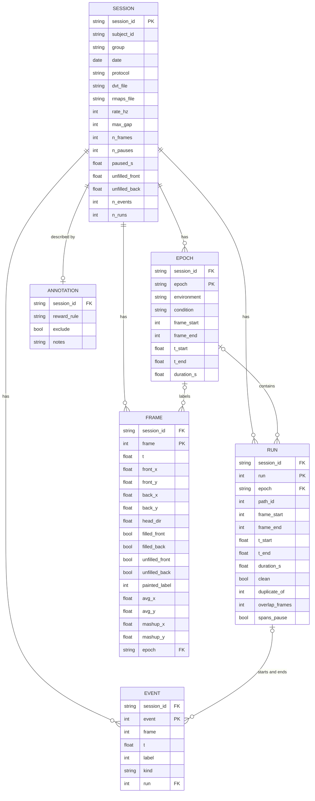

# Lab data tables

The technical reference for the lab's MATLAB files (section 1), the tables the converter writes (section 2) and the
rules left to stage 2 (section 3.1). The spec, the plan and the converter's code cite it by section number. The
plain-English terms live in `DATA_DICTIONARY.md`. Conventions throughout: seconds for time, pixels in the camera frame until stage 2
converts to metres in the room frame, angles in radians, one key (`session_id`) tying every table together.

## 1. Lab data (MATLAB files, outside the repository, read only)

Each recording has one tracking file and one analysis file. File names encode the
session: `<subject>_rec<N>_<MMDDYY><sss>[_tags]<kind>.mat`, for example
`NS16_rec32_110315001ProcessedDVT.mat` and `NS14_rec27_021915001_tt_rmaps_bilatmusc.mat`.
The folder (`NS14Data`, `JL1HPCData`) is the group. Both MATLAB formats occur; v7.3 files are
HDF5 and store arrays transposed and characters as integer codes.

### 1.1 Tracking file, `...ProcessedDVT.mat`

| variable | shape | meaning | used by the converter |
|---|---|---|---|
| `dvtFileName`, `dvtPathName` | char | original Plexon DVT file and its path on the lab machine | manifest only |
| `rawDVT` | (N, 6) | the DVT file as loaded: line (frame) number, timestamp, then each light's x and y in the tracker's own integer encoding (0 means lost, up to 1023), not camera pixels; `processedDVT` rescales them to camera pixels (x 639/1023 + 1), rounds them, fills gaps up to `maxGap` and adds two more lights | not read |
| `nRealLights` | 1 | number of tracked lights, 2 | manifest only |
| `sampleRate` | 1 | frames per second, 60; the lab computes it from the time column at rows 99 and 100, so a pause there would corrupt it | `rate_hz`, rounded, no fallback (a value that is not a finite number fails the session); a warn when it is not 60 |
| `maxGap` | 1 | longest gap in frames the lab interpolated across, half of `sampleRate`: 30 | `max_gap` in sessions.csv, rounded, no fallback (a value that is not a finite number fails the session); a warn when it is not 30 |
| `samplesLost` | (N, 2) | per light: frames the tracker lost | not read; it is the filled and unfilled flags together (lost = filled + unfilled, never both) |
| `samplesFilled` | (N, 2) | per light: lost frames the lab filled by interpolation (gaps of up to `maxGap` frames), as rounded integer positions | flags |
| `samplesUnfilled` | (N, 2) | per light: lost frames left empty, gap longer than maxGap | flags, NaN mask |
| `processedDVT` | (N, 10) | the cleaned tracking: frame, timestamp, LED1 x, y, LED2 x, y, then the average light x, y (the rounded midpoint; 1 where either light is unfilled) and the mashup light x, y (the average, or the one good light's position when only one is unfilled; 1 where both are unfilled). All positions are integers: the lab rounds every sample, not only the filled ones. Unfilled samples are 1 | frame, t, front and back positions; the average and mashup lights as `avg_x`, `avg_y`, `mashup_x`, `mashup_y` |
| `velSmoothWinSecs`, `velSmoothWinSamples` | 1 | the lab's velocity smoothing window, 0.1 s, 6 frames | manifest |
| `vel` | (N-6, 2, 2) | per light (last axis): row i is the displacement between tracking rows i and i+6 over 0.1 s, the lab's smoothing window; axis 2 is [speed in px/s, direction of motion in radians, atan2(dy, dx) in camera coordinates]; NaN where either end is unfilled. Aligned to the tracking with a 3-frame offset | not read; the lab's own derivation, which stage 2 recomputes from the positions |
| `acc` | (N-7, 2, 2) | the same, differenced once more | not used |
| `HDRadians` | (N,) | head direction: the angle of the vector from LED2 to LED1 in video coordinates, y pointing down, so LED1 is the front light; computed from the interpolated, rounded positions and set to NaN exactly where either light is unfilled | head_dir, as stored |

### 1.2 Analysis file, `..._rmaps.mat`, with `tt` and a variant tag in either order

Rate maps and the linearization machinery, per epoch. The converter uses the segmentation,
the event record and the painted run labels; the neural content stays here. Meanings marked "likely" are
inferred from names and shapes and need the MATLAB code or the paper to confirm.

| variable | shape | meaning | used by the converter |
|---|---|---|---|
| `timeStamps` | (4,) or (6,) | recording segment boundaries, interleaved start then end per segment; segment 1 is the platform (the lab's name for the arena), 2 the first session (the track), 3 the second session (the variant) when present; absent in some recordings. Clicked by hand in `TTAutoPosTracker`, which snaps each click to the nearest plotted sample; pressing Return after four clicks skips the second session. Each value is a 1-based row index into the tracking and a segment is the inclusive range from start to end | epochs; absent or unusable stamps give no epochs |
| `runTimeMarkers` | cell (nPaths, 2) as loaded; (2, nPaths) in the raw HDF5 layout | per path: start and end times of the clean runs only, seconds; copies the event times, shifted where those are | not read |
| `runPosMarkers` | cell (nPaths, 2) as loaded | per path: start and end row index of the clean runs only, into the tracking; not positions | the check against the clean pairs (a warn) |
| `pathList` | (nPaths,) | the path labels used in this session, not a fixed 1 to 12 (the first session examined has 1, 2, 3, 4, 9, 10) | the order of `nRuns` |
| `nRuns` | (nPaths,) | clean runs per path, in `pathList` order; duplicated runs are counted | the same check (a warn) |
| `nPaths` | 1 | number of paths in this session | not used |
| `masterTemplate` | (30, 2) | track skeleton points in pixels, likely the clicked outline | not read; stage 2 reads it with the stage 1 readers, for registration |
| `PathTemplate` | cell (12,) | per path, 140 template points, likely bin, x, y, one per centimetre of the 1.40 m run; true north uses bins 90 to 100 of paths 9 and 10 | not read; stage 2 |
| `Clicks`, `nMasterPoints`, `closestTemplatePoint` | various | the clicked points that built the templates and their matching | not used |
| `pos` | (N, 3) | time, x, y: the position the lab used | not used |
| `pixelDvt` | (N, 11) | the processed tracking plus a last column holding the run label per frame, painted by `TTPosTracker`: the run's signed start label (negative when dirty) over rows start to end inclusive, a later run overwriting an earlier one where they overlap, 99 for unlabeled | the frames' `painted_label`; the warn check on the run rows |
| `lostTrackingRows` | (162,) | rows dropped for lost tracking | not used |
| `timeSpent`, `meanTemplateOcc` | (15, 140), (6, 14, 140) | occupancy along the linearized template, likely per centimetre of the 1.40 m run | not used; stage 3 may compare |
| `binTemplateMatrix`, `nBins`, `cumSumNBins`, `nBinsThisSegment`, `defaultBinSize` | various | linearization binning | not used |
| `LinearRates`, `MeanLinearRates`, `PosRateMaps`, `TwoDRateMaps` | cells, (3, 500, 700, 5) | firing rate maps per neuron, linear and two-dimensional | never; neural |
| `nCells`, `allTfiles`, `tfileList`, `tfileFileName`, `tfilePathName` | various | number of neurons and their spike-time files | never; neural |
| `filterValues`, `filterValuesNormed`, `filterMedian`, `filterSigma`, `filterWidth`, `narrowGaussian`, `narrowGaussianNormed`, `narrowStdev`, `halfNarrow` | various | rate-map smoothing kernels | never |
| `spiral_events` | (n, 3) | the labelers' click record, one row per event: tracking row, the tracking timestamp at that row (the tracking `t`, `processedDVT` column 1 counting from 0, so it carries any pause), label. Made by `TTAutoPosTracker`, an automatic finder of gate crossings that searches only inside the two session segments, and edited by hand in `TTPosTracker`. A run's start and end are written together as two adjacent rows, an indecision point is a separate single row, and a reward click follows the end row; click order, not time order; label codes below | `events.csv` as stored; runs by pairing |
| `sampleRate`, `runsFileName`, `runsPathName`, `saveFile`, `varargin`, `ans` | various | provenance strings and MATLAB leftovers | `runsFileName`, `runsPathName`: manifest only; the others not read |

Label codes in `spiral_events`, column 3:

| label | meaning |
|---|---|
| `1` to `98` | run start on that path; positive means clean. In `TTPosTracker` the labeler's "Clean Run!" or "Dirty Run" button sets the sign; `TTAutoPosTracker` sets it by a rule (dirty when the chosen light's speed drops below 10 px/s inside the run), and a list may hold either |
| `-1` to `-98` | run start on that path, dirty |
| `101` to `198`, `-101` to `-198` | run end: the start label plus 100, with the same sign |
| `0` | an indecision point, a hesitation marked by the labeler; kept in events.csv, not used for runs; 903 of the 918 that lie within a run (in time) sit in a dirty one |
| `777` | a reward click; present in only 5 of 109 sessions, after a run's end in two and inside a run in three, because the tool's reward code is commented out; not used |
| `99` | unlabeled; appears only in `pixelDvt`'s painted column |

Path ids by segment: `TTAutoPosTracker` labels paths 1 to 4, 9 and 10 in the first session and 11 to 14, 19 and 20 in the second (the first set plus 10); the hand tool's buttons give 1 to 10 or 11 to 20.

### 1.3 Session fields from file and folder names

| field | from | example |
|---|---|---|
| `subject_id` | first token | `NS16` |
| `rec` | `rec<N>` | 32 |
| `date` | six digits, month day year | 2015-11-03 |
| `session` | three trailing digits | `001` |
| `kind` | `ProcessedDVT` or `rmaps` | |
| `tags` | the other tokens, matched without regard to case; seen in the file names: `tt`, `dark`, `bilatmusc`, `bilatACSF`, `leftmusc`, `leftACSF`, `plus45`, `plus45turn`, `plusquarter`, `plusquarterturn`. The variant tag comes either after `rmaps` or before it | `..._tt_rmaps_bilatmusc.mat`, `..._tt_plus45turn_rmaps.mat` |
| `group` | the folder | `JL1HPCData` |
| `session_id` | subject, rec, date, session | `NS16_rec32_20151103_001` |

### 1.4 What validating by hand found in the lab's files

Counts are over the 109 sessions unless a line says otherwise.

- Files: 220 `.mat` files, 218 parsed into 109 tracking and 109 analysis files, always one to
  one (JL1 14, NS14 32, NS15 33, NS16 30). Skipped by name: `allPLXFiles.mat` and
  `NS14_rec27_02191500_tt_rmaps_bilatmusc.mat`, a malformed twin, byte for byte, of
  `..._021915001_tt_rmaps_bilatmusc.mat`.
- Frames, in the first session of each group (four sessions, both formats): frame numbers are
  contiguous, `t` is the frame number times 0.016667 (not so in every file, see Pauses), the unfilled flags mark every sentinel,
  and the heading is exactly the angle from LED2 to LED1 (largest error 0.000 degrees), so two
  lights carry the heading. NS14_rec14 holds 41 samples outside 640 by 480, all of them
  interpolated by the lab. Unfilled fractions are 0.08 and 0.24 for the two lights of
  JL1_rec23.
- Stamps: `timeStamps` is present in 103 sessions, with 4 entries (71) or 6 (32), and absent
  in 6 (5 JL1 sessions and NS14_rec14). There are 6 entries exactly when the name carries a
  variant tag. The arena segment is under 10 s in NS14_rec1, NS14_rec19 and NS16_rec10, and
  the early NS14 sessions are one tracked stretch. In NS15_rec20 about 37 runs lie in the
  13,745 frames between the arena stamp and the track stamp.
- Segment 3: for infusion and dark it covers the same cells as segment 2 (overlap 0.70 to
  0.86, as for two halves of the track), the same maze; for `plus45` and `plusquarter` it
  covers a different layout (0.14 to 0.23), in two clusters per rat. `turn` is a naming
  suffix. No session has a fourth segment.
- Events: `spiral_events` holds 19,604 starts, 19,603 ends, 929 indecision rows and 36 reward
  rows, in click order in 100 of the 108 sessions where starts and ends alternate. Those hold
  14,177 clean runs and 5,313 dirty ones. No event lies in the arena segment. The markers and
  `nRuns` equal the clean runs in all 108.
- Pauses: in 32 of the 109 tracking files `t` jumps by minutes (a few up to about 56) between
  two consecutive frames, where the recording stopped and restarted. The frame number does not
  jump and the frames are contiguous in every file. Both labeling tools write the tracking timestamp at the event's row, so the lab's event times follow `t` and after
  a pause they differ from the row times 1/60 s by a constant. That is what looked like shifted
  event times in 33 sessions (314 to 3375 s in 31 NS sessions), except the starts of JL1_rec35 and
  JL1_rec36, off by 0.5 s and 0.3 s, which no pause explains. The rows are valid tracking rows in
  every session, and the painted `pixelDvt` column matches them to within 2 frames (median 0) in the four
  sessions tried, so rows are authoritative.
- Faults in the event list: events at row 0 with time 0 (NS16_rec31, NS16_rec6); a dirty start
  with no end (NS16_rec6); 5 duplicated runs (NS14_rec23 two, NS14_rec29 one, NS14_rec6 two);
  11 overlaps between neighbouring runs, the earlier ending 1 to 6 frames after the next
  starts (2 to 7 shared frames; runs touching at a single frame were not counted: JL1_rec35 one,
  JL1_rec36 eight, NS15_rec15 two). Probable causes, read from the labeling tools' code and not tested on the
  data: a row-0 pair is a relabel with nothing selected (the tool writes the new labels into an
  empty buffer, which MATLAB pads with zeros); duplicates come from the automatic finder, which
  makes a run at every start-gate crossing and ends each at the next end-gate crossing; no event
  lies in the arena because that finder searches only inside the two session segments.
- Reward rows (777): 32 after run ends in NS14_rec18, 1 after the last run in NS14_rec22, and
  1 inside a run in each of JL1_rec32, NS15_rec10 and NS15_rec7. The tool's reward code is
  commented out, so a reward was rarely marked.
- Heading offset (computed in stage 2, 3.1): in JL1_rec23 heading minus motion peaks near 105 degrees whichever light or
  speed floor is used (103 to 109 degrees), so the light bar sits close to sideways on the
  head.

## 2. Transformed lab data tables (stage 1, the converter's output)

Written under the transformed lab data root, the `TRANSFORMED_LAB_DATA` key in `configs/local.yaml`;
the lab data root is the `LAB_DATA` key in the same file, and the converter exits 2 naming the key
when either is missing. Native rate, pixels, camera frame; a conversion only: no row dropped, no
value edited, nothing resampled, registered or smoothed. None of it enters the artifact store,
which holds synthetic datasets, models and experiments only; the same holds for the stage 2 and
stage 3 products made from it.

```
<root>/
    sessions.csv   epochs.csv   runs.csv   events.csv      the tables
    annotations.csv                                        by hand; the converter never writes it
    manifest.json  checks.json                             bookkeeping
    frames/<session_id>.parquet                            one file per session
```

### 2.1 `sessions.csv`, one row per recording

| column | type | meaning |
|---|---|---|
| `session_id` | str, PK | as in 1.3 |
| `subject_id` | str | rat |
| `group` | str | folder name; likely the recorded region |
| `date` | date | recording date |
| `protocol` | str | `standard`, `rotation`, `infusion`, `dark` or `other`, from the file's variant tag (2.8), whatever the stamps gave |
| `dvt_file` | str | tracking file name |
| `rmaps_file` | str | analysis file name |
| `rate_hz` | int | the lab's `sampleRate` rounded, 60; no fallback: a value that is not a finite number, or that rounds to 0 in a session with epochs or runs, fails the session (`exception`), and a value other than 60 is written with the `rate_matches` warn holding the stored value. With `max_gap`, the one place stage 1 rounds a lab value |
| `max_gap` | int | the lab's `maxGap` rounded: the longest gap in frames it interpolated across, 30; no fallback, as `rate_hz`; a value other than 30 gives the `rate_matches` warn |
| `n_frames` | int | rows in the frames file; `n_frames / rate_hz` is the recorded time |
| `n_pauses` | int | steps in `t` over 0.1 s (1.4, Pauses) |
| `paused_s` | float | the time those steps skip: each step minus the camera's frame time 1/60 s (not the lab's `sampleRate`), summed |
| `unfilled_front`, `unfilled_back` | float | fraction of frames with that light unfilled |
| `n_events` | int | rows in events.csv for this session |
| `n_runs` | int | rows in runs.csv for this session |

### 2.2 `epochs.csv`, one row per epoch

| column | type | meaning |
|---|---|---|
| `session_id` | str, FK | |
| `epoch` | str, PK with session | one of the epoch vocabulary |
| `environment` | str | the config the geometry maps to |
| `condition` | str | from the analysis file's tag: one of the condition list (2.8), or an unknown tag verbatim |
| `frame_start`, `frame_end` | int | the lab's `timeStamps` pair for this segment, 1-based rows; every pair is kept, including segments under 10 s |
| `t_start`, `t_end` | float, s | the tracking timestamps at those rows |
| `duration_s` | float | `(frame_end - frame_start + 1) / rate_hz` |

### 2.3 `runs.csv`, one row per paired trip

| column | type | meaning |
|---|---|---|
| `session_id` | str, FK | |
| `run` | int, PK with session | 1-based, in start-frame order (ties by event order) |
| `epoch` | str or null, FK | the epoch holding the run's start frame; blank when none does |
| `path_id` | int | the lab's path id, the absolute value of the start label, copied verbatim |
| `frame_start`, `frame_end` | int | the event rows of the run's start and end, 1-based, as stored |
| `t_start`, `t_end` | float, s | the tracking timestamps at those rows; blank when a row lies outside the tracking (below 1 or beyond its last frame); the event time column is not used |
| `duration_s` | float | `(frame_end - frame_start + 1) / rate_hz` |
| `clean` | bool | the labeler's judgment, the sign of the run's start label; copied, never computed |
| `duplicate_of` | int or null | the earliest earlier run with the same signed start label (so a clean run is never a duplicate of a dirty one) that this one overlaps by at least half the shorter of the two; a flag, nothing is dropped |
| `overlap_frames` | int | the previous run's (in start order) `frame_end` minus this run's `frame_start` plus 1, and 0 when that is not positive; it equals the number of shared frames (runs touching at one frame give 1) except when this run lies inside the previous one, where it is larger (a run of 10 frames inside another gives 26 in `RULE_RUNS` in test_convert.py); stage 2 trims that many frames from the earlier run so it ends before this one starts; a flag, nothing is cut |
| `spans_pause` | bool | a pause frame p (the first frame after a jump in `t`) has `frame_start` < p <= `frame_end` |

### 2.4 `frames/<session_id>.parquet`, one row per 60 Hz frame

| column | type | meaning |
|---|---|---|
| `session_id` | str, FK | |
| `frame` | int, PK with session | the DVT frame number, 1-based, contiguous |
| `t` | float, s | the DVT timestamp as stored; jumps at a pause |
| `front_x`, `front_y` | float, px | LED1; NaN when unfilled |
| `back_x`, `back_y` | float, px | LED2; NaN when unfilled |
| `head_dir` | float, rad | the lab's heading as stored, camera convention; the lab sets it to NaN exactly where either light is unfilled (a warn here if it is not) |
| `filled_front`, `filled_back` | bool | interpolated by the lab |
| `unfilled_front`, `unfilled_back` | bool | missing |
| `painted_label` | int or null | the lab's per-frame run label, the last column of `pixelDvt`: the signed start label of the run the frame belongs to (negative when dirty; the later run where two overlap), 99 unlabeled; blank when the file has no `pixelDvt` or its rows, frame and time columns or width (one column more than `processedDVT`) do not match the tracking |
| `avg_x`, `avg_y` | float, px | the lab's average light (`processedDVT` columns 6 and 7), the rounded midpoint of the two lights; NaN where either light is unfilled |
| `mashup_x`, `mashup_y` | float, px | the lab's mashup light (columns 8 and 9): the average, or the one good light when only one is unfilled; NaN where both are unfilled |
| `epoch` | str or null, FK | the epoch whose frame range holds the frame; blank outside every epoch |

### 2.5 `events.csv`, one row per lab event

`spiral_events` as stored: the labeler's click record, in click order, nothing dropped.

| column | type | meaning |
|---|---|---|
| `session_id` | str, FK | |
| `event` | int, PK with session | 1-based position in click order |
| `frame` | int | the lab's tracking row, as stored; 0 for the placeholders (1.4) |
| `t` | float, s | the lab's event time, as stored; it follows the tracking `t`, so it jumps with pauses |
| `label` | int | the lab's label code (1.2) |
| `kind` | str | one of the event kind vocabulary, from the label |
| `run` | int or null, FK | the run this event starts or ends; blank for events not part of a pair |

### 2.6 `annotations.csv`, one row per recording, made by hand

`reward_rule` (str; from the paper's methods: `all_but_repeats` or `visit_all`), `exclude` (bool;
leave out of every statistic) and `notes` (free text), keyed by `session_id`. The converter never
reads, writes or deletes it; a missing file means no annotations. Join it to `sessions.csv` on
`session_id`.

### 2.7 Bookkeeping files

| file | contents |
|---|---|
| `manifest.json` | rewritten whole by every run, for that run only: a `run` block with `parameters` (the tracking columns used, the pause step, the heading and painted tolerances), the selection (`only`, `sample`), a `timestamp`, the sessions `written`, `failed` with their failed checks and `skipped` with reasons, and `row_counts`; and a `sessions` block, one entry per session written in the run: `written_at`, `provenance` (the lab's provenance values: null when absent or an empty number, `""` for an empty text value) and `rows` (row counts per table, frames included). Nothing hashes the lab files or records the environment |
| `checks.json` | `{session_id: {check: {status, detail}}}` for every session the run processed, written or failed, rewritten whole by every run; status is `pass`, `warn` or `fail`; the pauses are listed under their check with frame and seconds |

### 2.8 Vocabularies

Every allowed value, one row each, fixed in `convert.py`. The converter refuses a value outside the `epoch`,
`environment`, `kind` and `protocol` lists (that session fails as `exception`). `condition` is free text: a tag it has never seen is kept verbatim
(original case) on the variant epoch and reported.

`epoch`, a labeled interval of a session, named by its role in the lab's recording

| value | meaning |
|---|---|
| `arena` | the open arena, the lab's platform segment (segment 1); foraging happens here, and no run event lies in it |
| `track` | the triple-T track in its standard orientation (segment 2) |
| `variant` | the third segment, present when `timeStamps` has 6 usable entries, which in the lab's files is exactly when the file name carries a variant tag: a rotated track, or the same track under an infusion or in the dark; its environment and condition say which |

`environment`, the geometry config an epoch maps to

| value | meaning |
|---|---|
| `open_arena` | the 0.6 m circular arena, `configs/environments/open_arena.yaml` |
| `triple_t` | the standard track, `configs/environments/triple_t.yaml` |
| `triple_t_rot45` | the standard geometry rotated 45 degrees about the room center; config to add |
| `triple_t_rot90` | the standard geometry rotated 90 degrees about the room center; config to add |

`condition`, the experimental manipulation in force during an epoch

| value | meaning |
|---|---|
| `baseline` | no manipulation; a trained rat in an ordinary session |
| `rot45` | the track rotated 45 degrees for this epoch |
| `rot90` | the track rotated 90 degrees for this epoch |
| `musc_bilateral` | bilateral muscimol infusion, an inactivation; the whole file |
| `acsf_bilateral` | bilateral artificial cerebrospinal fluid, the vehicle control for muscimol; the whole file |
| `musc_left` | muscimol infused on the left side only; the whole file |
| `acsf_left` | artificial CSF infused on the left side only; the whole file |
| `dark` | recorded in the dark; the whole file |
| any other | an unknown file tag, kept verbatim on the variant epoch and listed in checks.json |

`kind` of an event, from its label

| value | meaning |
|---|---|
| `start` | a run start: label 1 to 98 or -1 to -98 |
| `end` | a run end: label 101 to 198 or -101 to -198 |
| `indecision` | label 0, a hesitation marked by the labeler |
| `reward` | label 777, a reward click |
| `other` | any other label; kept in events.csv, not checked |

`protocol`, a session-level label from the file's variant tag

| value | meaning |
|---|---|
| `standard` | no variant tag (none, or `tt`) |
| `rotation` | a `plus45` or `plusquarter` tag |
| `infusion` | a muscimol or ACSF tag |
| `dark` | the `dark` tag |
| `other` | a tag the converter has not seen |

File tags, matched without regard to case, and what each gives the file's epochs. Confirmed
by validating by hand: `turn` is only a naming suffix, and which of a rat's two rotation
clusters is 45 degrees and which 90 rests on the tag names until stage 2 registers the track.

| tag | variant epoch's environment | conditions |
|---|---|---|
| none, `tt` | no variant epoch; if the stamps have a usable third pair, a `variant` epoch in `triple_t` with the `stamps_usable` warn (status `tag`; one epoch per stamp pair) | `baseline` on every epoch |
| `plus45`, `plus45turn` | `triple_t_rot45` | `rot45` on the variant; arena and track `baseline` |
| `plusquarter`, `plusquarterturn` | `triple_t_rot90` | `rot90` on the variant; arena and track `baseline` |
| `bilatmusc`, `leftmusc` | `triple_t`, the same maze | `musc_bilateral`, `musc_left` on every epoch |
| `bilatACSF`, `leftACSF` | `triple_t`, the same maze | `acsf_bilateral`, `acsf_left` on every epoch |
| `dark` | `triple_t`, the same maze | `dark` on every epoch |

The arena's environment is always `open_arena` and the track's `triple_t`. An unknown tag leaves
the arena and track `baseline` and puts the tag on the variant epoch, in `triple_t`. The files do
not say which epochs were under an infusion or the dark: the tag names the whole file, so every
epoch carries its condition, a label from the file name and not a measurement.

### 2.9 Lab constants worth knowing

| constant | value | where |
|---|---|---|
| running | smoothed speed above 10 px/s and turning rate below 20 rad/s, both smoothed over 6 frames; our stage 2 heading offset uses its own rule, speed above 30 px/s (3.1) | `isRunningAnalysis` |
| pixel scale, first estimate | 10 px/s is called about 3 cm/s, so roughly 3.3 px per cm; stage 2 measures the real scale | same |
| angular velocity | the lab's is the turning rate of the direction of motion, not of the head; our statistics name both | same |
| true north | per recording, the mean raw heading on the straight north leg of paths 9 and 10, template bins 90 to 100; it also contains the track's angle to the camera, so it is left to stage 2 as a cross-check on the heading offset | `ratTrueNorthCalculator` |
| field names | `isRunningAnalysis` stores speed under `angVel` and turning rate under `vel`; read their struct by content, not by name | same |
| run labels | made by hand in `TTPosTracker`: start click, end click, path number, clean or dirty, reward click | same |

### 2.10 Keys and joins

`session_id` is on every row. A frame's `epoch` names a row in epochs for the same session; a
run's `epoch` names its epoch, or is blank when no epoch holds the run's start frame; an event's
`run` names the run it starts or ends. Frames carry the lab's painted label (`painted_label`, the signed start label of the lab's run, 99 when unlabeled) but not our run number: to
find a frame's run, join on the run's `frame_start` and `frame_end`. Dead time is a frame with no epoch.



## 3. Later stages

- Stage 2, cleaning, then room-frame trajectory blocks at 0.05 s: its spec when it exists. An
  earlier draft of the trajectory schema is on the `agents/trajectory-schema` branch.
- Stage 3, per-session statistics JSON and the pooled reference file: see the statistics
  spec when it exists.

### 3.1 What stage 2's cleaning starts from

Stage 1 keeps everything the lab stored. These are the rules validated by hand (tasks V1 to V5
and the lab-data notebooks) that stage 2 applies, each a filter or a label on the stage 1 tables
and none an edit of the lab's values. Where stage 1 already carries the flag, it is named.

- Runs. Of the events, drop those at row 0 (placeholders in NS16_rec31 and NS16_rec6) and any
  start with no end (NS16_rec6). Drop a run that duplicates an earlier run (`duplicate_of`;
  same label, overlapping by at least half the shorter): 5 in the data (NS14_rec23 two,
  NS14_rec29 one, NS14_rec6 two). Cut an overlap whose distance is up to 10 frames (`overlap_frames` up to 11) so the earlier
  run ends one frame before the next starts (11 cases at distance 1 to 6: JL1_rec35 one,
  JL1_rec36 eight, NS15_rec15 two). A larger overlap that is not a duplicate would be a fault;
  none was found. Indecision (0) and reward (777) rows are not runs.
- Epochs. A segment under 10 s is not an epoch (the arena in NS14_rec1, NS14_rec19 and
  NS16_rec10). For the six sessions without `timeStamps` (five JL1 sessions and NS14_rec14), the
  segments are the tracked stretches of 10 s or more, if their number is the expected 2 or 3 and
  none otherwise; a gap is both lights unfilled for over 10 s. NS15_rec20 has about 37 runs in the
  13,745 frames between its arena and track stamps.
- Pauses. Do not sample a trajectory across a pause (`spans_pause`, and `t` jumping in the
  frames). Event times and `t` agree with each other, never with the row times after a pause.
- Heading offset (`hd_offset_rad`, per recording). The circular mean of heading minus direction
  of motion over running frames: the direction of motion is that of the midpoint of the two
  lights over 6 frames (0.1 s), running is a speed above 30 px/s. It is the light bar's mounting
  angle on the head, from the tracking alone, in the arena as well as on the track; about 105
  degrees in JL1_rec23, whichever light or floor is used (103 to 109). Subtract it to get head
  direction relative to travel. Never use it to test whether the head follows travel: once it
  is subtracted the residual is zero-mean by construction.
- Phase. `run` inside a run, wherever it lies; `between` in track and variant time outside any
  run (the dwell at the goal and the return, split once stage 2 anchors it); `forage` in the
  arena; blank elsewhere.
- Conditions. The baseline set is `protocol` standard. Infusion and dark apply to the whole
  file, and a rotation variant is another layout.
- Checks that held in the data and become warns here: the lab's `nRuns` and the marker rows
  equal the clean pairs in all 108 sessions where starts and ends alternate; no event lies in the
  arena; the stamps are authoritative (103 of 103 valid); the lab's heading is NaN exactly
  where either light is unfilled (four sessions).

What the stage 1 tables support for statistics and synthetic data, as far as validation can say:

- Fit on baseline sessions, on clean track runs by `path_id`. Dirty runs (27% of the labeled
  runs) stay for comparison with real behavior. What clean means differs by tool (1.2): a
  button press by the labeler, or the automatic finder's speed rule.
- The arena has no run structure at all, so only frame-level foraging statistics can come
  from it.
- Path sequences come from the run numbers and the `between` intervals from the frames between
  runs; both depend on the rules above.
- Pooling sessions needs one frame. Whether the track sits at the same camera position on
  different days has not been checked; stage 2 registration decides it, and until then the
  pixel scale is the rough 3.3 px per cm.
- `head_dir` is a function of the two lights, and path ids, the painted label and the heading offset encode
  travel direction. `head_dir`, `painted_label`, `path_id` and the events' label are validation and analysis columns and stay out of anything the RNN
  trains on (AGENTS.md rule 1); whatever the RNN is given is one point, not both lights.
