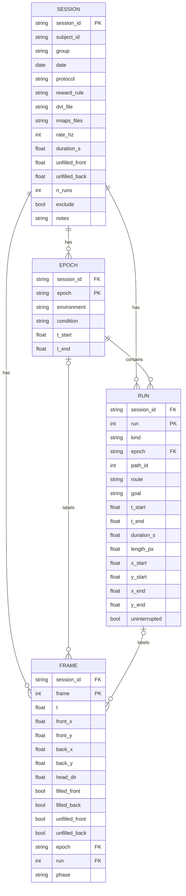

# 2026-10-04

Today's work will be running an EDA on the trajectory data and getting a better understanding of it. Notes on a generative model for trajectories, and what a sample DBN might look like...

