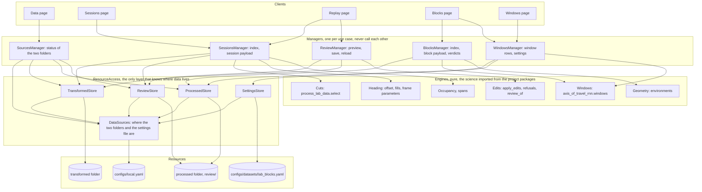

# RatReplay architecture

A standalone review tool for rat trajectory data: read two data folders in a known format, replay
sessions, confirm the blocks a processor will build, inspect built blocks and training windows,
and write small files that downstream tools read. Built here inside the project with pixi, meant
to become its own repository later. Localhost only, the data never leaves the machine.

This document is the design the code is reviewed against. Decisions, not options.

## Layering (volatility based, after Löwy)

Rules: a client talks to managers over HTTP only and never carries the identity of a data folder.
A manager calls engines and stores, never another manager, and hands the `DataSources` it is given
on to the stores. Engines are pure functions over arrays. Stores do file I/O and nothing else, and
ask `DataSources` where their folder or file is. `DataSources` is the one component that knows how
the folders are chosen (today `configs/local.yaml`, read the way the processor reads it, tomorrow a
flag or a picker), so that choice changes in one place. It imports no store. The Sources manager
checks the folders against the data format through the stores and is the one manager that asks
`DataSources` for the paths it shows. Science never lives in the tool: cuts, fills, offsets and windows
are imported from the project packages. Nothing is reimplemented in TypeScript except drawing
and interaction. Utilities (Arrow encoding, the clock, ids, formatting) sit beside every layer.

Where it bends on purpose: a page may use two managers, the Replay page previews edits through
the Review manager while editing (chatty, right for a localhost tool), and the frontend's draw
modules hold real geometry, which in a server system would be an engine.

## Backend, `ratreplay/backend/ratreplay_api/`

FastAPI on 127.0.0.1, one process, no database. Files are the state.

    app.py                 create_app(config_path), routes mounted, static frontend served at /
    routers/               the HTTP face of the managers, one module per use case, no logic
    stores/data_sources.py where the two folders and the settings file are: the config file, read at start and on reload
    stores/transformed.py  sessions, epochs, runs csv, frames parquet per session, manifest
    stores/processed.py    blocks csv, block parquet, manifest
    stores/review.py       read, write (overwrite whole), list, per session
    stores/settings.py     lab_blocks.yaml read and write
    engines/               cuts, heading, windows: thin wrappers naming the project functions used.
                           edits: the review rules. environment, occupancy, spans: the tool's own, small
    managers/sources.py    the two folders of the config: format contract, counts, mtimes, status
    managers/sessions.py   the session payload: arrays, epochs, runs, cut points, fills, auto blocks
    managers/review.py     apply edits (engines/edits), preview, save, reload
    managers/blocks.py     block index, block payload in metres with the environment, verdicts
    managers/windows.py    window counts, verdicts, settings save
    arrow.py               numpy dict to Arrow IPC bytes

### API (all JSON unless noted, errors as {"error": text} with 4xx)

    GET  /api/sources                      the transformed and processed folders of the config with path,
                                           status, problems, counts, mtimes, and the config file,
                                           ?reload=true reads the config file again first
    GET  /api/sessions                     session index rows (rat, date, protocol, in_dataset, epochs,
                                           runs, automatic blocks, review facts)
    GET  /api/sessions/{sid}               session payload as Arrow IPC (arrays) plus a JSON header
                                           (epochs, runs, cut points, fill spans, auto blocks, offset)
    GET  /api/sessions/{sid}/review        the review file or null
    PUT  /api/sessions/{sid}/review        body is the edits and notes, server applies and
                                           writes the file whole, returns the saved review
    POST /api/sessions/{sid}/review/preview   body is the edits, server applies them and
                                           writes nothing, returns the blocks, cuts, flagged
                                           runs and the edits skipped with their reasons
    GET  /api/blocks                       block index with verdicts at given settings
    GET  /api/blocks/{bid}                 block payload (Arrow) plus header (environment
                                           geometry, runs, trips, windows at settings)
    GET  /api/windows/settings  PUT /api/windows/settings   lab_blocks.yaml
    GET  /api/format                       the data format contract as JSON (files, columns, dtypes)
    GET  /api/openapi.json                 FastAPI's schema (the API page renders both)

A session and a block are each two requests: the JSON header at the route above, and under it at
`/arrays` the arrays as an Arrow IPC stream, one row per frame.

The folders are `TRANSFORMED_LAB_DATA` and `PROCESSED_LAB_DATA` in `configs/local.yaml`, the two keys
the processor reads, resolved the way it resolves them and read once at startup (or again on
`?reload=true`). `create_app(config_path)` takes another file instead, so tests never read the real one. No route
takes an id: the session routes read the transformed folder, the block and settings routes the
processed one. The transformed folder needs sessions.csv, epochs.csv, runs.csv, frames/,
manifest.json. A processed folder that has a manifest must hold the kind folders, and one the
processor has not run in yet is fine, since reviews live under its `review/` and the first save
creates it.

## Frontend, `ratreplay/frontend/`

Vite, TypeScript, Alpine.js for page state, D3 for scales, zoom, colour and canvas drawing,
Tailwind for layout. No framework beyond that.

    src/main.ts            boot, router (hash based), theme
    src/api/               typed client, Arrow decoding, one function per endpoint
    src/state/             Alpine stores: scalars and small lists only, never frame arrays
    src/session/           the loaded session's arrays as plain typed arrays, playback clock
    src/draw/timeline.ts   lanes on canvas: session, runs, frames, blocks (and windows, trips on the
                           blocks page), D3 zoom with wheel and drag, feature layers on and off
    src/draw/map.ts        the map canvas: occupancy, trail, point, heading arrow, environment
    src/pages/*.ts         one module per page, builds its cards and wires Alpine to the engines
    src/ui/                cards, buttons, chips, toasts, the keyboard essentials

UX rules: one fixed viewport, no page scroll, cards in a grid that flexes to the window, dark by
default with a light toggle, desktop only. Every action gets feedback: a toast on save that names
the file written and whether it overwrote one. Essential keys only: space, left and right (frame,
with shift one second), `[` `]` run, enter confirm, escape clear, z undo. Everything else is a
button or a chip.

## Pages

1. Data: the path the data takes through the tool, the two configured folders as cards (incoming
   transformed and outbound processed, each with resolved path, status, problems, counts, manifest
   time, last modified), the config file and a Reload button. The entry point. The other pages read
   the same two folders at load and gate on their status.
2. Sessions: a sortable index (click a header), one row per session, a row expands to its details
   (epochs with durations, runs, pauses, gaps, LED offset, review facts, automatic blocks), open.
3. Replay: the session review. Map, playback, timeline with lanes and feature chips (pauses,
   gaps, jumps, margins, heading lost, heading filled, heading held), zoom controls (whole session,
   zoom in, zoom out, fit block) besides the wheel, block cards with accept and reject, marks,
   split, remove, flag, undo, save with feedback.
4. Blocks: a sortable index of built blocks with verdicts, a block player in metres with the
   environment drawn, lanes for runs, trips and windows.
5. Windows: step through the windows of a block (previous, next, jump), each with its checks
   (position finite, heading measured share, trips inside, burn-in and horizon marked) and a
   per-window ok or trouble, totals for the block.
6. API: the format contract and the OpenAPI schema rendered as readable tables.
7. About: what the tool is, the rules it follows (never edits data, never removes behaviour), links.

## Testing

pytest for the backend: unit tests on managers and stores against synthetic folders, API tests
through FastAPI's test client for each route. Vitest for the TypeScript that holds logic: timeline
geometry (time to pixel and back under zoom), window math mirrored from Python against a shared
fixture file, state transitions of the review editor, key handling. Playwright for a few flows in
a real browser: read the data folders, open a session, confirm a block, save, reload shows it, open a
block, step windows. No tests of styling.

## Working rules

Small commits, one purpose each. Plain code: named values at the top, one-line docstrings, no
semicolons or dashes in prose. The old `src/ratreplay` is not touched and nothing here imports it, only
`backend/tests/test_parity.py` does, as the oracle, so that file and the old tool are deleted together.
Builders are Sonnet, every pass is reviewed by Opus against this document.
