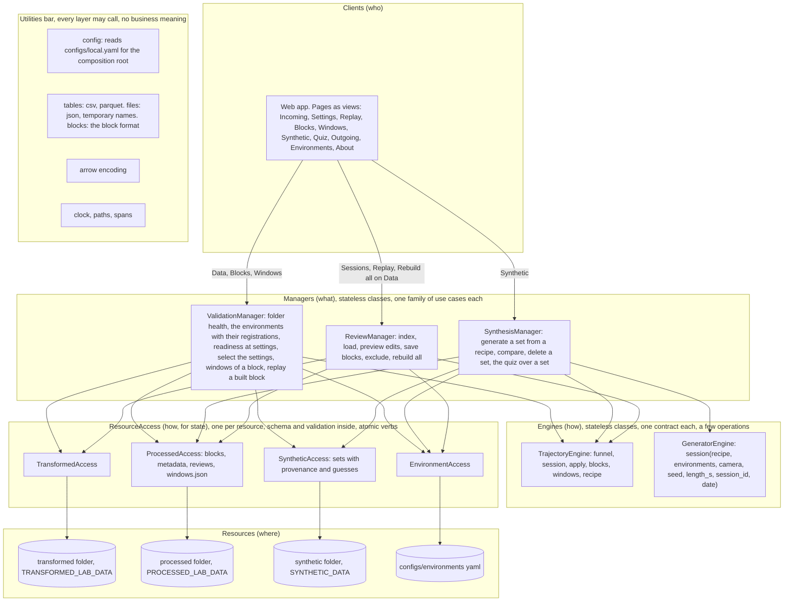
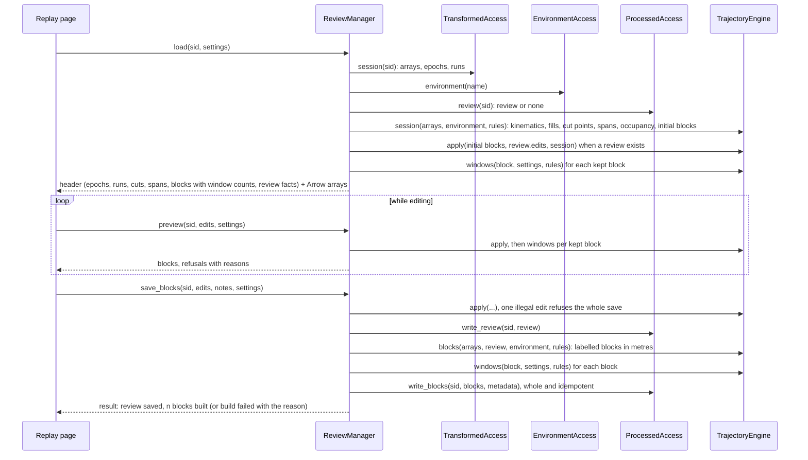
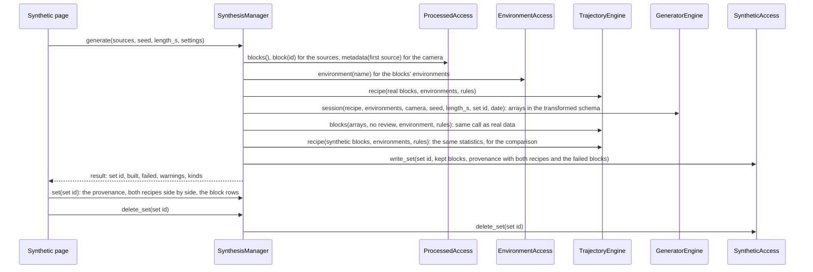
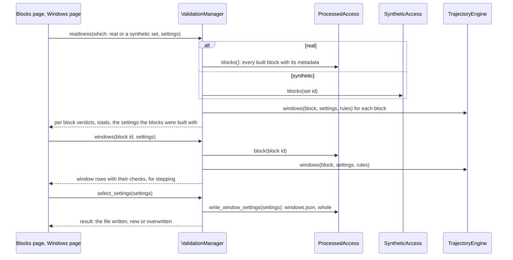
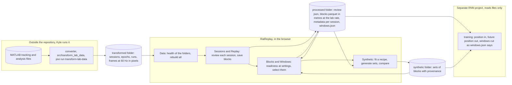

# RatReplay architecture

RatReplay turns transformed lab recordings into training ready real and synthetic trajectory
datasets, every block either human confirmed or carrying its provenance. It runs on localhost in one
process, the data never leaves the machine, and it is self contained: nothing is driven from a CLI or a
pixi task. It lives in this repository with its own backend and frontend so it can become its own
repository. Training is out of scope: the export (two data folders and a `windows.json`) is read as
files by a separate RNN project.

This document is the design the code is reviewed against. Decisions, not options. The thinking behind
them is in the working notes (`tmp/documents/ratreplay_contract.md` and
`tmp/documents/ratreplay_design_checklist.md`, uncommitted), including the Löwy checklist the design
was scored against.

## Objectives, from AGENTS.md

Nothing that encodes axis of travel reaches training (the RNN project enforces this on its inputs, the
blocks carry heading and labels for validation). Behavior generation is validated against real behavior
before it feeds training. Real recordings never enter the repository, they stay in the configured
folders. Artifacts are write once with provenance, seeds explicit, failures kept.

## Core use cases

The pipeline. Everything else is a side effect and must work but does not shape the design.

1. Review a session and save its blocks.
2. Generate a synthetic set from the real blocks and compare the two.
3. Judge a dataset's readiness at window settings and select the settings for export.

Required behaviors, as the researcher does them: see the health of the configured folders and the
specific problem when there is one. Find a session, replay it, see where the rules would cut it and why.
Accept, split, remove, make, flag and annotate blocks, undo, and see what each block yields in windows
while deciding. Save a session's blocks and get them back on the next load. Rebuild every session's
blocks after a rule change. Fit a recipe to real blocks, generate a synthetic set from it with a seed,
compare the two. Test window settings on real or synthetic blocks, step the windows of one block, select
the settings for export. Delete a synthetic set. Read what the tool is and the rules it follows.

## Glossary

Session: one recording of one rat on one day, the unit of review. Epoch: a stretch of a session under
one condition (arena, track, rotated track). Run: one traversal of a path in the lab's labelling (paths
1 to 4 outbound, 9 and 10 return). Trip: outbound run, dwell, return run, dwell, what a track block
must hold at least once to be training ready. Block: a continuous stretch of one epoch with no pause, gap or jump, at least 10 s, the
unit that is kept or removed and the unit of export. Initial blocks: the cuts the rules make before any
person edits. Review: a person's edits and notes on one session, one json file, the only thing a person
writes. Excluded: the person's decision that a session stays out of the dataset, a flag in its review with
a note, and who set it and when (never reviewer and review time). No rule excludes a session by a tag (group, protocol) and the annotations table's
exclude column is shown as a note, not applied. Built blocks: parquet files in metres at the lab rate (60 Hz) with trip and phase labels, written from a
review. Metadata: per session, what the build used (rules, settings, review stamp, code version, built
at) and per block the window count and verdict at those settings, informative, readiness recomputes them.
Window: a fixed length slice of a block at a stride with burn-in and horizon, cut by the RNN project,
never stored here. Settings: window length, stride, burn-in, horizon, rate. Readiness: the verdicts of
the windows of a dataset at given settings. Recipe: the statistics of real blocks the generator fits.
Set: one synthetic generation with its provenance. Environment: the geometry of the track or arena and
its registration to the camera. Export: the processed and synthetic folders and `windows.json`.

## Volatility

The decomposition follows what changes, on two axes: during this project (now) and once the tool
outlives it (later). A row low on both gets no component.

| Area of change | Now | Later | Encapsulated in |
|---|---|---|---|
| How a person reviews (UI rounds, cards, keys, what a save means) | high | medium | the pages, ReviewManager |
| Cutting and labelling rules and thresholds | high | medium | TrajectoryEngine, every rule a parameter |
| Window settings and readiness criteria | high | medium | parameters on `windows`, ValidationManager |
| What is stored per session and how, the export | medium | high | ProcessedAccess, SyntheticAccess |
| Where the folders are, what the lab's files look like | low | high | TransformedAccess, the config utility |
| Environment geometry and registration | medium | high | EnvironmentAccess, TrajectoryEngine |
| How synthetic behavior is generated | high | high | GeneratorEngine |
| What the recipe measures, how real and synthetic compare | medium to high | medium | TrajectoryEngine.recipe, SynthesisManager |
| Who the client is | low | low | no component, the HTTP entry |
| Rate, units, the block schema | low | low | no component, constants and schema in the accesses |
| MATLAB to transformed conversion | low | medium | stays a project script, joins later as a fourth manager |

Weak volatilities given no component: toasts and feedback (client), clock and ids (utilities), hosting.

## Static architecture

Arrows point in the direction of the call.

### Rules

- The architecture is closed. A component calls the layer beneath it and utilities, nothing else.
  Clients call managers only, one manager per use case. Managers call engines and accesses. Engines
  take arrays in, give arrays out, and call only utilities. An access calls its one resource.
- Nobody calls upward or sideways: engines never call engines, accesses never call accesses, managers
  never call managers. There is no bend anywhere in this design.
- Every component is a class with no state of its own, named by the book (noun plus Manager, Engine or
  Access), constructed once at the composition root in `app.py` with the components it calls. A manager
  gets its engines and accesses, an access gets its root. Nothing imports a sibling, tests hand in fakes.
  A component may have private helper modules of its own (`engines/trajectory/`, the environment
  access's builders), imported by that component alone, which the layering test pins.
- Managers are workflows, almost expendable: a change to a use case changes a manager's workflow and the
  pages, never the engines or accesses beneath. Each rule and threshold is a parameter of an engine
  operation. Each access owns its resource's schema, layout and validation errors and exposes whole,
  idempotent business verbs, never file paths or CRUD.
- UI state (selection, zoom, cursor, layers, the loaded arrays, the window settings being tried) lives in
  the client. The server stores nothing between requests, files are the state.
- Window settings are a parameter on every call that needs them. They are recorded in the per session
  metadata when blocks are built and in `windows.json` when selected for export, never held globally.
- The science lives in the two engines and nowhere else. Nothing is reimplemented in TypeScript except
  drawing and interaction.
- The API and the page carry one `FORMAT_VERSION` each, compared on load. Any change to a payload shape
  (a key added, removed or reshaped in a route's answer) bumps both in the same commit, so a page served
  against an older process says "restart the API" instead of failing on the missing key.
- One named exception to the arrows: `schemas.py`, the request bodies the routers validate, reads two
  constants two layers down, the edit fields from `access.processed` and the default settings from
  `engines.trajectory`, so the API's defaults and the stored format cannot drift apart. The layering
  test pins it to exactly those two. Unknown keys in a body are refused, never dropped.
- The block format (the parquet and index columns) is shared by two resources, the processed folder and
  the synthetic sets, so it lives in `utilities/blocks.py` and both accesses read it from there, the
  json, temporary name and key check helpers beside it in `utilities/files.py`. An access still owns
  its layout and its own files' schemas (reviews, metadata, provenance, guesses).
- One named exception to statelessness: SynthesisManager keeps the open quiz pairs in memory under
  opaque ids, so the page never holds a block id before the reveal. Lost on restart, which only closes
  the unanswered pairs.

## Components

### TrajectoryEngine

One contract, six operations, every rule and threshold a parameter (`rules`, `settings`).

- `funnel(tables, rules)`: from the sessions, epochs and annotations tables and the ids with frames,
  per session whether it is in the dataset, why not (two reasons only, the things the tool cannot work
  around: no arena or track epoch under the rules' condition, no frames), the epochs the rules select
  and `annotated_exclude`, the annotations table's exclude flag, a note and never applied. No protocol or
  group rule: the person excludes, ReviewManager records it. What the index shows without reading frames.
- `session(arrays, environment, rules)`: kinematics in metres and the smoothed position for drawing, heading offset and fills (interpolated up
  to the fill limit, held when still, else missing), stops, cut points (pauses, gaps, jumps with
  margins, epoch bounds), spans (heading lost, filled, held, margins), occupancy, initial blocks, and
  the rules it used. What the Replay page draws, and what `apply` reads its rules from.
  Each heading span carries `first`, `last`, `seconds` and the `reason` the fill decided it (over the fill limit, contains a pause,
  touches an end of the recording, no measured heading on either side, interpolated, held), so the page words no rule.
  The registration records the measured start offset (start site to bottom corridor peak, in metres).
- `apply(blocks, edits, session)`: the edit legality rules (no overlap with a kept block, no kept block
  under the minimum length, no block outside its epoch, no edit on a removed block, a moved edge snaps
  to a run edge within `snap_s`), the resulting blocks and the refusals with reasons.
- `blocks(arrays, review, environment, rules)`: the labelled blocks (trip, phase, frames in metres at
  the lab rate) for a session, from the review's blocks or the initial blocks when there is none.
  The same call for real and generated arrays.
- `windows(block, settings, rules)`: the window rows (start, end, burn-in, horizon, complete and
  partial trips inside, measured heading share, position finite) and the verdict of each, plus the
  block's verdict listing every rule it breaks (no window fits, measured heading share under the minimum
  over the block, and on a track block only, fewer complete trips over the whole block than
  `min_complete_trips`). A window needs no trip of its own. `rules` gives the return paths that end a
  trip, the rules the block was built with. `settings["rate_hz"]` is the RNN project's resampling rate,
  recorded in `windows.json`, and plays no part here, the arithmetic runs at the block's own rate. The
  verdict rules live here only.
- `recipe(blocks, environment, rules)`: the statistics the generator fits and the numbers real and
  synthetic are compared on, per kind (speed and turn rate distributions, still fraction, heading spread
  against the per frame step direction, pauses, and on the track run durations, dwell times, trips and
  goal shares, in the arena the distance to the environment's boundary and the occupancy over its room),
  the geometry of the blocks' environments given by name so real and synthetic are measured in one frame.
  An arena pause is a still stretch over `pause_min_s`, since the labels paint no pause in the arena.

### GeneratorEngine

`session(recipe, environments, camera, seed, length_s, session_id, date)`: a session in the transformed
schema (camera pixels, two LEDs, one arena epoch then one track epoch of the lengths asked for, dated
`date` so a set reproduces from its provenance) from an explicit RNG, so SynthesisManager blocks it with
the same `TrajectoryEngine.blocks` call as real data. It knows the triple T and the circular arena alone
and refuses another geometry, and a track recipe it cannot draw a trip from, as Invalid. The behaviour
it generates is recorded in `docs/plan.md` (Synthetic slice design).

### ReviewManager

`index()`, `load(sid, settings)`, `preview(sid, edits, settings)`, `save_blocks(sid, edits, notes,
settings)`, `exclude(sid, excluded, note)`, `rebuild_all(settings)`. Save blocks applies the edits first
and one illegal edit refuses the whole save with its reason, nothing written, as does a session the
person excluded ("include it first"). Then it writes the review, then builds from the review
on disk (arrays, `blocks`, `windows` per block, `ProcessedAccess.write_blocks`) in one private step that
`rebuild_all` runs for every session with a review. The one partial outcome is an I/O failure of the
build after the review is written, returned as a result, not an error.

Exclude(sid, excluded, note, settings) records the person's decision in the session's review, rewritten
whole with `excluded`, `excluded_by` and `excluded_at` (set when excluding, kept when including) and the
note appended to its notes. `reviewed_by` and `reviewed_at` are never touched, so an exclusion neither
reviews a session nor changes the build's review stamp. With no review it writes one of the initial
blocks as they are (status auto, no edits, never reviewed), or with no blocks when the funnel leaves the
session out, so any session with frames can be excluded. Excluding then builds the session empty at
once: the build of an excluded session writes no blocks and metadata saying `excluded`, so its blocks
leave `blocks.csv`, readiness and the Blocks page without a Rebuild all (which does the same for every
excluded session, even one the funnel also leaves out). Including writes the review only and the person
saves or rebuilds, except when the review was only the exclusion's (never reviewed, no edits, every block
auto): then `ProcessedAccess.delete_review` and `delete_build` remove it with the session's metadata, and
the session is as before the exclusion. The result is the save's shape plus `deleted`, `review` being none
when removed.

`rebuild_all` returns `{sessions, skipped, excluded, totals}`: `sessions` the outcome of every review
built (built, failed, build_error, an excluded one with zero built), `skipped` the reviews of sessions
the funnel leaves out (no frames, no epoch of the rules) by session id with the reason, not built,
`excluded` the notes of the excluded sessions, `totals` the counts of sessions, built, failed, errors,
skipped and excluded. A review of a session the transformed folder lacks is a per session build_error. The
index rows and the header carry `excluded` and `annotated_exclude`, the rows also `excluded_by` and
`excluded_at`. A review file written before these keys existed reads as not excluded (the defaults live
in `ProcessedAccess.review`).

### SynthesisManager

`index()`, `set(set id)`, `generate(sources, seed, length_s, settings)`, `delete_set(set id)`, and the
quiz: `pair(set id, kind)`, `pair_block(pair id, side)`, `pair_arrays(pair id, side)`, `guess(set id,
pair id, side)`, `tally(set id)`, `guesses(set id)`. Generate reads the source blocks, fits the recipe
over their environments, generates under the first source's camera and environments, blocks the result
with the same engine call as real data, computes the recipe of the synthetic blocks for the comparison,
and writes the set with its provenance (sources, environments, camera, seed, lengths, rules, settings,
code and generator versions, both recipes, warnings, the blocks that failed and were not written). The
settings are recorded only: readiness on `set:{id}` windows the set's blocks on demand, as it does real
ones. A pair holds one real block of the set's sources and one synthetic block of one kind, the real one
on a side drawn at random, the real one taken from the environment the set was generated in so both
backdrops are one, and the two sides are served with only what the quiz player draws (`x`, `y`,
`heading`, `speed`, the kind, environment, length and rate, the geometry): no ids, runs, trips, phases,
fills, lights, registration or `t` (which a real block keeps from its place in the session), any of
which would tell the sides apart. A guess closes the pair,
is appended to the set's `guesses.json` and returns the reveal with the set's tally.

### ValidationManager

`health()`, `format()`, `environments()`, `readiness(which, settings)`, `block(block id)`,
`arrays(block id)`, `windows(block id, settings)`, `select_settings(settings)`, `selected()`. Health and
format come from the accesses alone, no engine. Environments lists every yaml environment with its
parameters and geometry and the built sessions registered against it, each with the registration its
metadata holds (read only, no arithmetic). The environment of a registered kind is found from the
session's epochs, the ones the funnel selects under the rules the session was built with, since the
metadata names no environment. Readiness reads built blocks (real, or one synthetic set) and calls
`windows` on each under the rules the block's session was built with (from its metadata), it never re
cuts a session. Select settings writes `windows.json` whole, the one thing this manager writes, and is
refused while nothing is built. Selected reads it back.

### Accesses

- `TransformedAccess(root)`: `health()`, `schema()`, `sessions()`, `session(sid)` (arrays, epochs,
  runs, the manifest stamp). Read only.
- `ProcessedAccess(root)`: `health()`, `schema()`, `review(sid)`, `reviews()`, `write_review(sid,
  review)`, `blocks()`, `block(block id)`, `metadata(sid)`, `write_blocks(sid, blocks, metadata)`
  (a session's blocks, index rows and metadata replaced whole, through temporary names and a rename),
  `window_settings()`, `write_window_settings(settings)`.
- `SyntheticAccess(root)`: `health()`, `schema()`, `sets()`, `set(set id)` (the provenance),
  `blocks(set id)`, `block(set id, block id)`, `find_block(block id)` (the set holding it),
  `write_set(set id, blocks, provenance)` (whole, through a temporary folder and a rename, refused when
  the set exists), `delete_set(set id)`, `guesses(set id)`, `write_guess(set id, guess)`.
- `EnvironmentAccess(root)`: `health()`, `environments()`, `environment(name)` from
  `configs/environments/*.yaml`. The yaml is the compact definition (type, room, params, or a base and a
  transform) and expanding it into walls, centerline, boundary and reward sites is part of reading the
  resource, done by the access's private `environment_builders.py`. Functions over a geometry (inside,
  registration, distance to a wall) are engine maths.

Each access reports its root as a fact for the Data page, never its layout.

### Utilities

`config` (reads `configs/local.yaml`, returns a key's value or a named error, knows nothing about the
keys), `tables` (csv and parquet in and out), `files` (json in and out, temporary names, safe stems,
required keys), `blocks` (the block format both block folders share), `arrow` (numpy dict to an Arrow
IPC stream), `spans` (stretches of equal values as indices), `clock`, `paths`, `version`, `errors`.
Nothing else until a second system needs it.

## The core use cases as call chains

### 1. Review a session and save its blocks

Rebuild all is the lower half alone, from the Data page with a confirmation: `rebuild_all(settings)`
lists the reviews and runs the same private build step for every session, an excluded one writing no
blocks.

### 2. Generate a synthetic set and compare it with the real blocks

The quiz over a set: `pair(set id, kind)` draws one real block of the sources (`PA.blocks()`) and one
synthetic block of the set (`SA.blocks(set id)`) and keeps them in memory under an opaque pair id, the
page reads each side (`pair_block`, `pair_arrays`, from `PA.block` or `SA.block`) with nothing that tells
them apart, and `guess(set id, pair id, side)` writes the guess (`SA.write_guess`), closes the pair and
reveals it with the tally (`SA.guesses`).

### 3. Judge readiness at window settings and select them

The three chains have one shape: read an access, call the engine, write or return. That symmetry is a
review check, an asymmetric chain is investigated before it is built.

### A future use case, to show the design extends without rework

The converter joins RatReplay: a `ConversionManager` over a new `LabDataAccess` (the MATLAB files),
writing through `TransformedAccess`, which gains write verbs. A fourth manager and a fifth access,
inside the counts, and the three managers above do not change.

## The operational flow

## Resources on disk

The three folders come from `configs/local.yaml`: `TRANSFORMED_LAB_DATA`, `PROCESSED_LAB_DATA`,
`SYNTHETIC_DATA`, read once at start by the composition root (`create_app(config_path)` takes another
file in tests). Edit the file and press Reload on the Data page to change a folder.

    transformed/   sessions.csv, epochs.csv, runs.csv, frames/{sid}.parquet, manifest.json   (read only)
    processed/     review/{sid}.json            the person's edits, notes and exclusion, written whole
                   blocks/{block_id}.parquet    one built block, metres, the lab rate, trip and phase labels
                   blocks.csv                   one row per built block, a session's rows replaced together
                   metadata/{sid}.json          rules, settings, review stamp, code version, built at, and per
                                                block the window count and verdict at those settings (informative)
                   windows.json                 the selected window settings, readiness totals, when, by whom
    synthetic/     sets/{set_id}/blocks/{block_id}.parquet, blocks.csv, provenance.json   one generated session, blocked, written whole
                   sets/{set_id}/guesses.json   the quiz guesses against the set, appended one at a time, absent before the first
    configs/environments/{name}.yaml            the compact definition of each environment

A session's processed files are staged under temporary names and renamed into place in one short pass,
so a failure while building leaves the previous build whole. A crash inside the rename pass itself can
leave the index naming files that are gone or orphan files with no row, and health reports both
(missing block files, orphan parquet or temporary files), so the state is loud and the next save of that
session repairs it. A session with blocks on disk loads them back and overwrites them on the next save.
Block ids are the session id, the epoch and a number within the epoch, as the processor formed them.

## Backend, `ratreplay/backend/ratreplay_api/`

FastAPI on 127.0.0.1, one process, no database.

    app.py                    create_app(config_path): the composition root, routes mounted, static frontend at /
    routers/review.py         the HTTP face of ReviewManager, no logic
    routers/synthesis.py      SynthesisManager
    routers/validation.py     ValidationManager
    managers/review.py        ReviewManager
    managers/synthesis.py     SynthesisManager
    managers/validation.py    ValidationManager
    engines/trajectory/       TrajectoryEngine in __init__.py, private modules behind it (cuts, heading,
                              labels, edits, windows, recipe, geometry), pure functions over arrays
    engines/generator.py      GeneratorEngine
    access/transformed.py     TransformedAccess, with the transformed schema
    access/processed.py       ProcessedAccess, with the review, block, metadata and windows.json schemas
    access/synthetic.py       SyntheticAccess, with the set, provenance and guess schemas
    access/environment.py     EnvironmentAccess, with environment_builders.py as its private helper
    utilities/                config, tables, files, blocks (the shared block format), arrow, spans, clock, paths, version, errors (the error shape)

The old `src/process_lab_data` and `src/axis_of_travel_rnn.windows` are not imported: their science is
moved into `engines/trajectory/` and they are removed once a real dataset has been built with this tool.

### API

JSON unless noted, errors as `{"error": text}` with 4xx, results as objects. Window settings travel as
query parameters on GET and in the body otherwise.

    GET  /api/health                         the three folders: root, exists, problems, counts, times, the config file
                                             (?reload=true reads the config again first)
    GET  /api/format                         the schemas each access declares (files, columns, dtypes)
    GET  /api/environments                   per environment: name, kind, params, geometry, summary (n_sessions, n_warned)
                                             and the built sessions registered against it with their registration
    GET  /api/sessions                       index rows (rat, date, protocol, epochs, runs, initial blocks, review facts,
                                             in_dataset and reason, excluded, annotated_exclude)
    GET  /api/sessions/{sid}                 header: epochs, runs, cuts, spans, blocks with window counts, offset, review,
                                             the environments geometry, warnings, refusals, in_dataset and reason,
                                             excluded, annotated_exclude
    GET  /api/sessions/{sid}/arrays          the arrays as an Arrow IPC stream
    POST /api/sessions/{sid}/preview         body edits and settings, returns blocks and refusals, writes nothing
    PUT  /api/sessions/{sid}/blocks          body edits, notes, settings, saves the review and builds the blocks
    PUT  /api/sessions/{sid}/exclusion       body excluded, note, settings: excludes (and builds the session empty at once) or
                                             includes (writes the review, or removes it when it was only the exclusion's),
                                             returns review (none when removed), replaced, file, deleted, built, failed, build_error
    POST /api/rebuild                        body settings, rebuilds every reviewed session, returns sessions, skipped, excluded, totals
    GET  /api/blocks?which=real|set:{id}     readiness: block rows with verdicts at settings, totals, built settings
    GET  /api/blocks/{bid}                   header: row with rate_hz, environment geometry, runs, trips, phases, heading spans (and /arrays as Arrow)
    GET  /api/blocks/{bid}/windows           window rows with their checks at settings
    GET  /api/windows   PUT /api/windows     the selection {"selected": windows.json or null}, and select (returns replaced and file)
    GET  /api/sets   POST /api/sets          synthetic sets, and generate one (body: sources, seed, length_s per kind, settings)
    GET  /api/sets/{id}                      the provenance with both recipes and the block rows
    DELETE /api/sets/{id}
    POST /api/sets/{id}/pairs                open a quiz pair (body: kind or null), returns pair_id, kind, sides
    GET  /api/pairs/{pair_id}/{side}         one side of a pair: row (kind, environment, n_frames, duration_s, rate_hz), rate_hz, geometry
                                             (and /arrays as Arrow: x, y, heading, speed), nothing that tells the sides apart
    POST /api/sets/{id}/guesses              body pair_id and side, records the guess, closes the pair, returns the reveal and the tally
    GET  /api/sets/{id}/guesses              the tally and every guess
    GET  /api/openapi.json                   FastAPI's schema, About renders it under the hood, the Data page renders /api/format

## Frontend, `ratreplay/frontend/`

Vite, TypeScript, Alpine.js for page state, D3 for scales, zoom, colour and canvas drawing, Tailwind for
layout. No framework beyond that.

    src/main.ts            boot, hash router, theme
    src/api/               typed client, Arrow decoding, one function per endpoint
    src/state/             Alpine stores: scalars and small lists only (health, the settings being tried), never arrays
    src/session/           the loaded session's arrays as typed arrays, playback clock, the editor's edit list
    src/draw/              timeline lanes and the map on canvas, zoom, feature layers, environment, occupancy
    src/pages/             one module per page, builds its cards and wires Alpine to the api client
    src/ui/                cards, buttons, chips, toasts, tables, the keyboard essentials

The client holds no rule. Drawing geometry (metres to pixels, lane layout) is presentation and stays.
Window math is not mirrored, the block cards show what the manager returned.

UX rules: one fixed viewport, no page scroll, cards in a grid that flexes to the window, dark by default
with a light toggle, desktop only. Every action gets feedback, a toast on a write names the file and
whether it overwrote one. Essential keys only: space, left and right (frame, with shift one second),
`[` `]` run, enter confirm, escape clear, z undo. Everything else is a button or a chip.

## Pages

Each page is one step of the flow, in the order a person walks it (decided 2026-10-18 after the first
run on real data).

1. Incoming: the entry point. A compact config strip (the lab data read path, the environment geometry
   read path, the config file, Reload, a status mark each, problems unfold only when there are any),
   then the sessions: a row of tiles (in the dataset of the total, reviewed, excluded, blocks confirmed,
   confirmed hours per kind, built), the sortable index, a row expands to its details, Exclude and
   Include, Open in replay, and the incoming data format collapsed at the bottom.
2. Settings: the seven window settings, each with a one line hint of what it protects and its default,
   the spelled out sentence, Select these settings for export with the current selection shown, reset to
   the defaults, and the engine's rules read only with their values and meanings (changing one is a code
   change and a Rebuild all today).
3. Replay: the review. A status header (the session id large, the facts, the state as one strong chip,
   warnings as chips), the map in metres with layer checkboxes, playback with notes and flag a run under
   it, the timeline with its lanes, the editing buttons in one row under the lanes, the zoom block (Reset
   view, +, -, Zoom to block), a side panel of layer toggles each with its meaning and the rule's number,
   block cards with window counts and verdicts at the settings in use, Save blocks with its result toast.
   Errors and warnings stack at the top right with their time until closed by hand.
4. Blocks: readiness. Real or a synthetic set, a compact read only line of the settings in use with a link
   to Settings, a sortable index with verdicts and the settings each session was built with, totals, a
   block player in metres with the environment and lanes for runs, trips and windows.
5. Windows: step through the windows of one block, each with its checks and verdict.
6. Outgoing: the block write path with its status, per session the blocks built, the settings they were
   built with, failed blocks and their problems, excluded and skipped sessions, the selected
   `windows.json`, Rebuild all with its confirmation, later the synthetic sets, and the processed data
   format collapsed at the bottom.
7. Environments: every environment with its parameters, its geometry drawn, and per built session the
   registration it was given (scale, measured start offset, rotation, LED separation and offset, warnings), read only.
8. About: what the tool is and the rules it follows, the process and how to use it, what each action
   writes, and "Under the hood", the internal routes the browser uses as a cheat sheet (not a public API).

The synthetic slice adds two pages between Windows and Outgoing: Synthetic (the sets, generate one from
built sessions with a seed and lengths, the two recipes side by side, delete) and Quiz (a real and a
synthetic block of one kind side by side, trail, playback and speed trace, the guess, the reveal and
the set's tally).

## Testing

Heavy unit tests on the engines only, a few integration tests per manager, a few system tests. Tests do
not sit beside the code they test.

    backend/tests/unit/          TrajectoryEngine and GeneratorEngine: rules, thresholds, edge cases, parity with the
                                 old processor and tool until they are removed
    backend/tests/integration/   one file per manager, real accesses over synthetic folders, a handful of use case
                                 walks each, no HTTP
    backend/tests/system/        a few flows through the HTTP client: save blocks, rebuild all, health, readiness
    frontend/tests/              Vitest on the pure TypeScript: timeline geometry, the editor's state transitions, keys
    frontend/e2e/                Playwright, two or three flows in a real browser

`backend/tests/unit/test_layering.py` asserts the import graph of the chart: routers import managers,
managers import engines and access, engines import utilities only, access imports utilities only.

## Migration from the current code

| Today | Becomes |
|---|---|
| `stores/data_sources.py` | gone, `app.py` reads the config utility and wires the accesses |
| `stores/settings.py`, `configs/datasets/lab_blocks.yaml` | gone, `windows.json` through `ProcessedAccess` |
| `stores/transformed.py` | `access/transformed.py`, TransformedAccess |
| `stores/processed.py`, `stores/review.py` | `access/processed.py`, ProcessedAccess |
| `stores/folder.py`, `schemas.py`, `contract.py` | inside the accesses and `utilities/tables.py` |
| `engines/cuts.py, heading.py, edits.py, windows.py, occupancy.py, spans.py, environment.py` and the science they import from `src/` | `engines/trajectory/`, TrajectoryEngine, the science moved in |
| new | `engines/generator.py`, `access/synthetic.py`, `access/environment.py`, `managers/synthesis.py` |
| `managers/sessions.py`, `managers/review.py` | `managers/review.py`, ReviewManager |
| `managers/sources.py`, `managers/blocks.py`, `managers/windows.py` | `managers/validation.py`, ValidationManager |
| `routers/*` | three routers, one per manager |
| `arrow.py`, `clock.py`, `errors.py` | `utilities/` |
| `frontend/src/session/windows.ts` and its test | gone, the client shows what the manager returns |
| `frontend/src/state/sources.ts` | `state/health.ts` |
| `frontend/src/**/*.test.ts` | `frontend/tests/`, cut to the pure modules |
| `frontend/e2e/*.spec.ts` | two or three flows |

Build order, by layers: utilities, then accesses, then engines, then managers and routers, then pages,
with the system tests last. The old `src/ratreplay` and `src/process_lab_data` are removed in their own
commit once a real dataset has been built with this tool.

## Working rules

Small commits, one purpose each. Plain code: named values at the top, one line docstrings, no semicolons
or dashes in prose. Builders are Sonnet, every pass is reviewed by Opus against this document and the
layering test. Never the labnotebook files. Kyle runs everything that touches real data.
